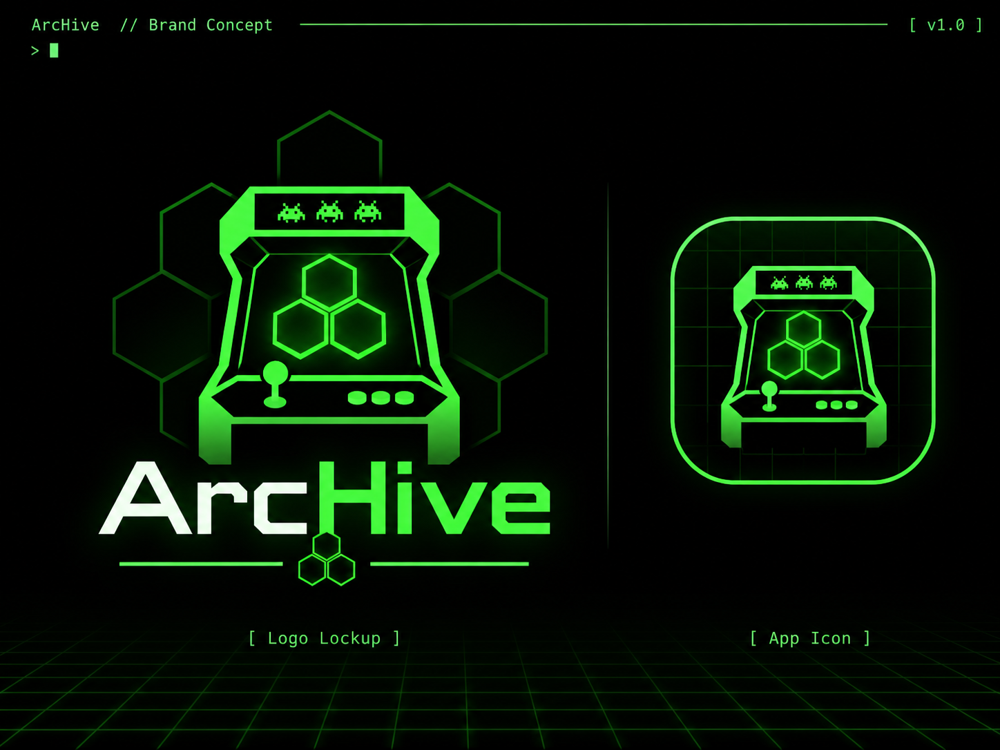

# ArcHive — standalone game library



RAR/7z extraction is enabled by default alongside ZIP. Build with the .NET 10 SDK:

```powershell
dotnet build ArcHive.App/ArcHive.App.csproj -c Release
dotnet run --project ArcHive.App/ArcHive.App.csproj
dotnet run --project ArcHive.Tests/ArcHive.Tests.csproj
```

Add a library folder, select a game, and use Extract archive. Choose a new destination parent; the app creates a unique game directory. Select the executable explicitly before launching. Tags, favorites, played status, notes and cover images are stored in %LOCALAPPDATA%\ArcHive. Scanning never launches games.

Extraction uses pinned SharpCompress 0.50.9 for RAR/7z and the existing ZIP adapter. Solid archives are read sequentially; 7z entry order is reconciled with the preflight plan. Paths, duplicate names, declared and actual output size are checked before publication. Files are created in staging without overwriting existing games. Ordinary failures and cancellation clean staging. Encrypted and incomplete archives are unsupported. Original archives are retained.

This is not a malware sandbox. Extract into a user-controlled local directory without hostile concurrent filesystem changes. Limits bound output size and entry count, not decoder memory or CPU; cancellation cannot interrupt a decoder until its read returns. Crash recovery, full format-specific link metadata coverage, checksum-corruption corpus testing and GUI validation remain release-hardening work. No archive metadata is used to create filesystem links or restore special attributes.

See VALIDATION.md for exact tests. ARCHITECTURE.md retains the original roadmap; its first-increment status descriptions are historical.


## ArcHive continuation

The project, namespaces and build output now use ArcHive throughout. See [ROADMAP.md](ROADMAP.md) for implemented/planned features, [design/DESIGN.md](design/DESIGN.md) for the approved branding, and [CONTINUATION.md](CONTINUATION.md) for library preservation.

The adaptive artwork grid, background thumbnails, optional details and archive view are implemented. New scans clean CamelCase/snake_case and explicit version/platform labels without renaming originals or overwriting edited titles. Online providers and advanced roadmap features remain planned.

## Windows packaging

Run `powershell -NoProfile -File packaging/Build-Installer.ps1` to publish the self-contained Windows x64 app and build the per-user MSI. Output: `artifacts/publish/win-x64/ArcHive.exe` and `artifacts/installer/ArcHive-0.5.0-win-x64.msi`. No separate .NET runtime is required by the installed application. Build prerequisites and verification commands are in [packaging/README.md](packaging/README.md).

The approved icon is embedded in ArcHive.exe, the Start Menu shortcut and the Installed Apps entry. The sidebar blends the original logo into its surface without a black image rectangle. Windows uses its standard file-type icon for the .msi file itself. The package is currently unsigned.

## Versions, progress and launch profiles (0.2.0)

Choose a progress state in game details and filter it beside Search. Progress and the Played flag are independent: launching records Played and last launch time without changing Completed or Abandoned.

Expand **Versions and release history** to record a latest-known version and source note. In **Files and launch setup**, select an archive or installation to edit its version, platform and channel. Numeric versions are compared within matching platform/channel values; unsupported version formats show Unknown. These are local/manual observations, not live online update checks.

Each installation can have multiple launch profiles. Create a profile, choose its executable, add one editable row per argument and optionally a working directory (relative to the installation or an absolute path inside it). A blank working directory uses the executable's folder. Blank argument rows represent empty arguments; arguments are literal, with no shell expansion. **Make default** selects the profile restored for that installation. **Save details and profiles** persists edits. Every launch shows the resolved command and directory before execution.

Existing SQLite libraries upgrade automatically with a retained pre-v2 backup. Older binaries cannot read schema 2; see [SQLITE-MIGRATION.md](SQLITE-MIGRATION.md) for rollback. This milestone was verified with automated tests and a Release build; full UI automation was intentionally skipped.

## Metadata lookup and review (0.4.0)

Select a game and choose **Find metadata**. Select VNDB, Steam, IGDB, itch.io or RAWG, then explicitly search or import a local JSON candidate array. Use **Provider settings** for your own API keys (and IGDB client ID/secret); optionally remember them in Windows Credential Manager. Nothing goes online merely by opening the dialog. Paths and notes stay local. Steam matches against its downloaded ID/title catalog; itch.io matches your owned games or editable projects, not a public search catalog. IGDB, RAWG and VNDB use title searches. See [METADATA.md](METADATA.md) for the import format, matching rules, provider scope and attribution.

Select a candidate to compare current/proposed values. Existing values are unchecked by default; check only the fields you want to replace. Apply saves those fields with source identity and retrieval time. **Undo metadata** restores the last applied batch, unless a later manual edit would be overwritten. Title, description, tags, release year and engine edits are recorded as manual. Cancel leaves the lookup unapplied. The four additional adapters are included in 0.4.0. Artwork selection and caching are available in 0.5.0; F95Zone integration remains future work.


## Artwork and gamepad controls (0.5.0)

In **Find metadata**, select a candidate, scroll to its artwork and press **Preview** to download an image. Choose **Use as Cover**, **Backdrop**, or **Screenshot**, then **Apply selected changes** to save your choices (text fields are optional). Roles are independent, and an image can be used in more than one role. Existing images are preserved until explicitly replaced; screenshots append without duplicates, up to 24. In **Selected artwork**, clear a cover/backdrop or remove screenshots. The existing local-image action remains a fallback. Artwork choices do not use the text-metadata Undo stack.

IGDB supplies covers, artwork and screenshots; RAWG supplies backgrounds and available search-result screenshots; VNDB supplies covers/screenshots; itch.io supplies covers. Steam's supported catalog supplies no image URLs, so ArcHive does not guess or scrape them. PNG/JPEG images load asynchronously into a bounded disk cache and remain available offline while cached. See [ARTWORK-GAMEPAD.md](ARTWORK-GAMEPAD.md) for limits and behavior.

Controller-support icons appear on game cards marked **Full** or **Partial** in the **Controller input support** selector. Unknown and None show no icon. Set this manually, or explicitly accept a provider's controller-support field; no support is inferred from the game's platform. Save details after editing.

With **Gamepad navigation** enabled, an XInput-compatible controller can use the D-pad/left stick to select games, shoulder buttons to switch All/Favorites/Archives, and A to open launch confirmation. Release A and press it again to confirm; B cancels. ArcHive must be active and not editing a text box/selector or running another operation. Clicking the game grid leaves editing mode. Input pauses when a game takes focus. The setting is session-only; unsupported DirectInput-only controllers need an XInput-compatible mapping. Automated input simulation passed; physical-controller/end-to-end UI testing was not performed.
